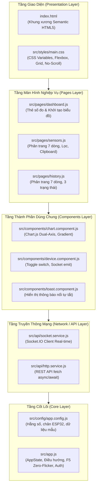
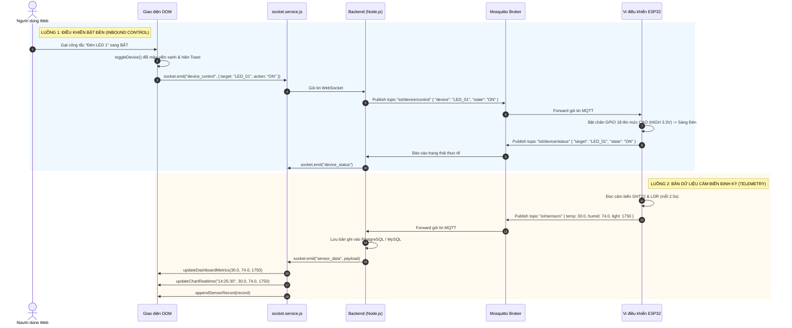

# GIẢI THÍCH CHI TIẾT MÃ NGUỒN FRONT-END (HTML5, CSS3, JAVASCRIPT, SOCKET.IO, CHART.JS)
## DỰ ÁN: HỆ THỐNG GIÁM SÁT MÔI TRƯỜNG & ĐIỀU KHIỂN THIẾT BỊ THỜI GIAN THỰC
* **Thư mục phân tích:** [`frontend/`](file:///D:/Code/VSCode/projectIOT/frontend/)
* **Ngôn ngữ & Thư viện:** HTML5, CSS3, JavaScript ES6+, Socket.IO Client 4.7.2, Chart.js, Phosphor Icons
* **Sinh viên:** Đỗ Trọng Ninh - B23DCCN633 - Nhóm 10 - PTIT
* **Giảng viên hướng dẫn:** ThS. Nguyễn Quốc Uy

---

## 📑 MỤC LỤC
1. [Tổng quan kiến trúc Front-End & Mô hình SPA Modular](#1-tổng-quan-kiến-trúc-front-end--mô-hình-spa-modular)
   - [1.1. Cấu trúc cây thư mục Front-End & Phân bổ trách nhiệm](#11-cấu-trúc-cây-thư-mục-front-end--phân-bổ-trách-nhiệm)
   - [1.2. Bảng tổng hợp đối chiếu toàn bộ các HÀM trong Front-End](#12-bảng-tổng-hợp-đối-chiếu-toàn-bộ-các-hàm-trong-front-end)
   - [1.3. Bảng tổng hợp đối chiếu các BIẾN SỐ & TRẠNG THÁI (State Variables)](#13-bảng-tổng-hợp-đối-chiếu-các-biến-số--trạng-thái-state-variables)
   - [1.4. Luồng xử lý dữ liệu thời gian thực (Real-time Data Flow)](#14-luồng-xử-lý-dữ-liệu-thời-gian-thực-real-time-data-flow)
2. [Chi tiết tệp gốc `index.html` & Kỹ thuật Zero-Flicker View Restoration](#2-chi-tiết-tệp-gốc-indexhtml--kỹ-thuật-zero-flicker-view-restoration)
3. [Chi tiết hệ thống kiểu dáng `src/styles/main.css` & Bố cục No-Scrollbar](#3-chi-tiết-hệ-thống-kiểu-dáng-srcstylesmaincss--bố-cục-no-scrollbar)
4. [Tệp cấu hình trung tâm `src/config/app.config.js`](#4-tệp-cấu-hình-trung-tâm-srcconfigappconfigjs)
5. [Bộ điều phối ứng dụng `src/app.js` (AppState & Single Source of Truth)](#5-bộ-điều-phối-ứng-dụng-srcappjs-appstate--single-source-of-truth)
6. [Tầng giao tiếp mạng `src/api/` (WebSocket Socket.IO & HTTP REST)](#6-tầng-giao-tiếp-mạng-srcapi-websocket-socketio--http-rest)
7. [Các thành phần giao diện dùng chung `src/components/`](#7-các-thành-phần-giao-diện-dùng-chung-srccomponents)
   - [7.1. Biểu đồ môi trường đa trục Y `chart.component.js`](#71-biểu-đồ-môi-trường-đa-trục-y-chartcomponentjs)
   - [7.2. Điều khiển công tắc đèn `device.component.js`](#72-điều-khiển-công-tắc-đèn-devicecomponentjs)
   - [7.3. Thông báo Toast nổi `toast.component.js`](#73-thông-báo-toast-nổi-toastcomponentjs)
8. [Các màn hình nghiệp vụ `src/pages/`](#8-các-màn-hình-nghiệp-vụ-srcpages)
   - [8.1. Màn hình Tổng quan `dashboard.js`](#81-màn-hình-tổng-quan-dashboardjs)
   - [8.2. Màn hình Cảm biến `sensors.js` (Bộ lọc 2 giai đoạn, Phân trang 7 dòng, Clipboard)](#82-màn-hình-cảm-biến-sensorsjs-bộ-lọc-2-giai-đoạn-phân-trang-7-dòng-clipboard)
   - [8.3. Màn hình Lịch sử `history.js` (Phân trang 7 dòng, 3 trạng thái điều khiển)](#83-màn-hình-lịch-sử-historyjs-phân-trang-7-dòng-3-trạng-thái-điều-khiển)
9. [Luồng dữ liệu thời gian thực từ ESP32 đến Giao diện (Sequence Diagram)](#9-luồng-dữ-liệu-thời-gian-thực-từ-esp32-đến-giao-diện-sequence-diagram)
10. [Bộ 10 câu hỏi vấn đáp chuyên sâu Front-End khi bảo vệ đồ án](#10-bộ-10-câu-hỏi-vấn-đáp-chuyên-sâu-front-end-khi-bảo-vệ-đồ-án)

---

### 1. TỔNG QUAN KIẾN TRÚC FRONT-END & MÔ HÌNH SPA MODULAR

Ứng dụng web được xây dựng theo mô hình **Single Page Application (SPA - Ứng dụng một trang)** với kiến trúc mã nguồn module hóa chuẩn công nghiệp:



#### Ưu điểm của kiến trúc:
1. **Separation of Concerns (Phân tách mối quan tâm):** Giao diện (HTML/CSS), xử lý dữ liệu (Pages), tái sử dụng (Components) và truyền thông mạng (API) nằm ở các tệp tách biệt.
2. **Hiệu năng cao:** Không cần thư viện nặng nề (như React/Vue/Angular), chạy trực tiếp trên JavaScript thuần (Vanilla JS ES6+) giúp tốc độ nạp trang $< 50ms$.
3. **Độ tin cậy cao (Fault-tolerant):** Tự động phát hiện Backend; nếu Backend chưa bật hoặc mất mạng, hệ thống tự chuyển sang bộ mô phỏng dữ liệu `startSimulatedTelemetry()` mà không gây sập giao diện.

---

### 1.1. Cấu trúc cây thư mục Front-End & Phân bổ trách nhiệm

```
frontend/
├── index.html                   # Khung xương HTML5 chính, nạp toàn bộ màn hình và module JS
├── public/
│   └── images/
│       └── avatar.svg           # Ảnh đại diện sinh viên (SVG vector tối ưu)
└── src/
    ├── app.js                   # [Core] Điều phối ứng dụng, quản lý AppState, chuyển màn hình
    ├── config/
    │   └── app.config.js        # [Config] Quản lý hằng số, chân ESP32, dữ liệu mẫu
    ├── api/
    │   ├── http.service.js      # [Network] Tầng gọi REST API (fetch async/await: history)
    │   └── socket.service.js    # [Network] Tầng WebSocket thời gian thực (Socket.IO client, giả lập data)
    ├── components/
    │   ├── chart.component.js   # [UI] Biểu đồ môi trường đa trục thời gian thực (Chart.js)
    │   ├── device.component.js  # [UI] Công tắc bật/tắt thiết bị đèn LED, trạng thái Đang chờ (Pending), ACK
    │   └── toast.component.js   # [UI] Hệ thống thông báo Toast nổi tự hủy sau 3.5 giây
    ├── pages/
    │   ├── dashboard.js         # [View] Cập nhật số đo các thẻ cảm biến trên màn hình Tổng quan
    │   ├── sensors.js           # [View] Bảng dữ liệu cảm biến, bộ lọc tích hợp, phân trang 7 dòng, Copy
    │   └── history.js           # [View] Bảng lịch sử điều khiển, lọc hành động/trạng thái, phân trang 7 dòng
    └── styles/
        └── main.css             # Định kiểu giao diện chính, biến màu CSS, bảng, biểu đồ, No-Scroll layout
```

---

### 1.2. Bảng tổng hợp đối chiếu toàn bộ các HÀM trong Front-End

| Tên Hàm | Tệp Chứa | Tham số nhận vào | Chức năng & Luồng hoạt động |
| :--- | :--- | :--- | :--- |
| [`switchView()`](file:///D:/Code/VSCode/projectIOT/frontend/src/app.js#L14) | [`src/app.js`](file:///D:/Code/VSCode/projectIOT/frontend/src/app.js) | `viewId`, `element` | **Chuyển đổi màn hình hiển thị:** Xóa class `.active` khỏi toàn bộ menu và section, thêm `.active` cho màn hình mục tiêu (`dashboard`, `sensors`, `history`, `profile`), và lưu `viewId` vào `sessionStorage` để không bị mất trang khi nhấn F5. |
| [`restoreActiveView()`](file:///D:/Code/VSCode/projectIOT/frontend/src/app.js#L38) | [`src/app.js`](file:///D:/Code/VSCode/projectIOT/frontend/src/app.js) | Không có | **Khôi phục trang khi reload (F5):** Đọc `activeView` từ `sessionStorage`, gọi `switchView()` tới trang đó, và xóa thẻ `#early-view-style` ở `<head>` để bàn giao quyền render mượt mà không chớp nháy (Zero-Flicker). |
| [`HttpService.getSensorHistory()`](file:///D:/Code/VSCode/projectIOT/frontend/src/api/http.service.js#L7) | [`src/api/http.service.js`](file:///D:/Code/VSCode/projectIOT/frontend/src/api/http.service.js) | `page`, `limit` | Gửi HTTP GET tới `/api/sensors/history` để lấy danh sách dữ liệu đo từ cơ sở dữ liệu PostgreSQL. |
| [`HttpService.getControlHistory()`](file:///D:/Code/VSCode/projectIOT/frontend/src/api/http.service.js#L24) | [`src/api/http.service.js`](file:///D:/Code/VSCode/projectIOT/frontend/src/api/http.service.js) | `page`, `limit` | Gửi HTTP GET tới `/api/controls/history` để lấy nhật ký bật/tắt thiết bị từ cơ sở dữ liệu. |
| [`SocketService.initConnection()`](file:///D:/Code/VSCode/projectIOT/frontend/src/api/socket.service.js#L30) | [`src/api/socket.service.js`](file:///D:/Code/VSCode/projectIOT/frontend/src/api/socket.service.js) | Không có | **Khởi tạo kết nối WebSocket:** Kết nối tới Backend qua thư viện Socket.IO, đăng ký lắng nghe 5 sự kiện: `connect`, `disconnect`, `sensor_data`, `device_control_ack`, và `device_status`. Nếu Backend chưa bật, tự động fallback sang chế độ mô phỏng vi sai. |
| [`SocketService.setDeviceOnlineStatus()`](file:///D:/Code/VSCode/projectIOT/frontend/src/api/socket.service.js#L6) | [`src/api/socket.service.js`](file:///D:/Code/VSCode/projectIOT/frontend/src/api/socket.service.js) | `isOnline` (`boolean`) | Cập nhật nhãn trạng thái và hiệu ứng đèn nhấp nháy xanh (`ESP32 ONLINE`) hoặc xám/đỏ (`ESP32 OFFLINE`) trên thanh Header. |
| [`SocketService.startSimulatedTelemetry()`](file:///D:/Code/VSCode/projectIOT/frontend/src/api/socket.service.js#L117) | [`src/api/socket.service.js`](file:///D:/Code/VSCode/projectIOT/frontend/src/api/socket.service.js) | Không có | **Chế độ kiểm thử độc lập:** Chạy hàm `setInterval` mỗi 2.5 giây, sinh dữ liệu nhiệt độ (22-38°C), độ ẩm (40-95%), ánh sáng (50-3500 lux) ngẫu nhiên theo đồ thị vi sai thực tế để phục vụ bảo vệ đồ án khi không có phần cứng. |
| [`initEnvironmentChart()`](file:///D:/Code/VSCode/projectIOT/frontend/src/components/chart.component.js#L6) | [`src/components/chart.component.js`](file:///D:/Code/VSCode/projectIOT/frontend/src/components/chart.component.js) | Không có | Khởi tạo biểu đồ đường đa trục (Dual-Axis) Chart.js trên `<canvas id="realChart">`, thiết lập gradient màu mờ, trục trái cho Nhiệt độ/Độ ẩm (0-100), trục phải cho Ánh sáng (0-4000 lux). |
| [`updateChartRealtime()`](file:///D:/Code/VSCode/projectIOT/frontend/src/components/chart.component.js#L170) | [`src/components/chart.component.js`](file:///D:/Code/VSCode/projectIOT/frontend/src/components/chart.component.js) | `timeLabel`, `temp`, `humid`, `light` | Đẩy điểm đo mới vào cuối mảng dữ liệu của Chart, dùng cơ chế FIFO giữ tối đa 12 điểm, và gọi `chart.update('none')` để cập nhật tức thì với hiệu năng 60 FPS không giật lag. |
| [`toggleDevice()`](file:///D:/Code/VSCode/projectIOT/frontend/src/components/device.component.js#L46) | [`src/components/device.component.js`](file:///D:/Code/VSCode/projectIOT/frontend/src/components/device.component.js) | `itemId`, `deviceKey`, `checkbox` | Xử lý khi click công tắc: giữ nguyên vị trí cũ, kích hoạt trạng thái Đang chờ (`is-pending`), khóa nút, ghi log `pending` và phát tín hiệu `device_control` qua Socket.IO tới Backend. |
| [`handleDeviceControlAck()`](file:///D:/Code/VSCode/projectIOT/frontend/src/components/device.component.js#L118) | [`src/components/device.component.js`](file:///D:/Code/VSCode/projectIOT/frontend/src/components/device.component.js) | `response` | Xử lý phản hồi từ Backend: tắt trạng thái `is-pending`. Nếu thành công thì BẬT/TẮT nút và chuyển log sang `success`; nếu thất bại thì giữ nguyên và chuyển log sang `failed`. |
| [`showToast()`](file:///D:/Code/VSCode/projectIOT/frontend/src/components/toast.component.js#L6) | [`src/components/toast.component.js`](file:///D:/Code/VSCode/projectIOT/frontend/src/components/toast.component.js) | `message`, `type` | Sinh động phần tử HTML thông báo nổi (`info`, `success`, `warning`, `error`), gắn vào `#toast-container` và tự động mờ dần biến mất sau 3.5 giây. |
| [`updateDashboardMetrics()`](file:///D:/Code/VSCode/projectIOT/frontend/src/pages/dashboard.js#L7) | [`src/pages/dashboard.js`](file:///D:/Code/VSCode/projectIOT/frontend/src/pages/dashboard.js) | `temp`, `humid`, `light` | Cập nhật trực tiếp số liệu vào DOM của 3 thẻ: `#metric-temp`, `#metric-humid`, `#metric-light`. |
| [`renderSensorTable()`](file:///D:/Code/VSCode/projectIOT/frontend/src/pages/sensors.js#L48) | [`src/pages/sensors.js`](file:///D:/Code/VSCode/projectIOT/frontend/src/pages/sensors.js) | Không có | Lọc mảng `sensorDataList` theo `appliedSensorFilters`, cắt dữ liệu theo trang hiện tại (7 bản ghi/trang), tự động thêm dòng trống `.empty-row` để giữ cố định vị trí phân trang, và hiển thị bảng. |
| [`goToSensorPage()`](file:///D:/Code/VSCode/projectIOT/frontend/src/pages/sensors.js#L148) | [`src/pages/sensors.js`](file:///D:/Code/VSCode/projectIOT/frontend/src/pages/sensors.js) | `page` (`number`) | Kiểm tra tính hợp lệ của số trang và cập nhật `currentSensorPage`, sau đó gọi lại `renderSensorTable()`. |
| [`handleManualFilterSensor()`](file:///D:/Code/VSCode/projectIOT/frontend/src/pages/sensors.js#L159) | [`src/pages/sensors.js`](file:///D:/Code/VSCode/projectIOT/frontend/src/pages/sensors.js) | Không có | Đọc ô tìm kiếm và dropdown chọn trường $\rightarrow$ gán vào `appliedSensorFilters`, đưa `currentSensorPage = 1` và vẽ lại bảng. |
| [`resetSensorFilters()`](file:///D:/Code/VSCode/projectIOT/frontend/src/pages/sensors.js#L176) | [`src/pages/sensors.js`](file:///D:/Code/VSCode/projectIOT/frontend/src/pages/sensors.js) | Không có | Đưa form tìm kiếm và dropdown về mặc định `"ALL"`, xóa sạch bộ lọc áp dụng và tải lại dữ liệu từ trang 1. |
| [`appendSensorRecord()`](file:///D:/Code/VSCode/projectIOT/frontend/src/pages/sensors.js#L196) | [`src/pages/sensors.js`](file:///D:/Code/VSCode/projectIOT/frontend/src/pages/sensors.js) | `record` (`object`) | Chèn bản ghi cảm biến mới nhất nhận từ WebSocket vào đầu mảng `sensorDataList` (`unshift`) và vẽ lại bảng theo thời gian thực. |
| [`copyTimeToClipboard()`](file:///D:/Code/VSCode/projectIOT/frontend/src/pages/sensors.js#L219) | [`src/pages/sensors.js`](file:///D:/Code/VSCode/projectIOT/frontend/src/pages/sensors.js) | `timeStr`, `btn` | Sao chép chuỗi mốc thời gian vào Clipboard bằng `navigator.clipboard.writeText`, đổi biểu tượng nút thành dấu tích xanh `ph-check` trong 1.8 giây và hiện Toast xác nhận. |
| [`renderControlHistoryTable()`](file:///D:/Code/VSCode/projectIOT/frontend/src/pages/history.js#L36) | [`src/pages/history.js`](file:///D:/Code/VSCode/projectIOT/frontend/src/pages/history.js) | Không có | Lọc và hiển thị danh sách nhật ký điều khiển gồm 3 trạng thái (`success`, `pending`, `failed`), phân trang cố định 7 dòng/trang. |
| [`handleManualFilterHistory()`](file:///D:/Code/VSCode/projectIOT/frontend/src/pages/history.js#L162) | [`src/pages/history.js`](file:///D:/Code/VSCode/projectIOT/frontend/src/pages/history.js) | Không có | Áp dụng bộ lọc lịch sử theo thời gian, thiết bị, hành động (BẬT/TẮT) và trạng thái điều khiển. |
| [`appendControlLog()`](file:///D:/Code/VSCode/projectIOT/frontend/src/pages/history.js#L198) | [`src/pages/history.js`](file:///D:/Code/VSCode/projectIOT/frontend/src/pages/history.js) | `log` (`object`) | Chèn một lượt bật/tắt thiết bị mới vào đầu danh sách lịch sử `controlHistoryList` và vẽ lại bảng. |
| [`updateControlLogStatus()`](file:///D:/Code/VSCode/projectIOT/frontend/src/pages/history.js#L210) | [`src/pages/history.js`](file:///D:/Code/VSCode/projectIOT/frontend/src/pages/history.js) | `logId`, `newStatus` | Cập nhật trạng thái bản ghi lịch sử điều khiển từ `pending` sang `success` hoặc `failed`. |

---

### 1.3. Bảng tổng hợp đối chiếu các BIẾN SỐ & TRẠNG THÁI (State Variables)

| Tên Biến | Tệp Khai Báo | Kiểu Dữ Liệu | Phạm Vi (Scope) | Chức Năng Chi Tiết |
| :--- | :--- | :--- | :--- | :--- |
| **`AppState`** | [`src/app.js`](file:///D:/Code/VSCode/projectIOT/frontend/src/app.js#L1) | `Object` | Toàn cục (`window.AppState`) | **Nguồn chân lý duy nhất (Single Source of Truth):** Quản lý toàn bộ trạng thái sống của app gồm: `isOnline` (kết nối ESP32), `socket` (đối tượng kết nối Socket.IO), `backendUrl` (URL máy chủ), `devices` (trạng thái bật/tắt hiện tại của 3 đèn LED). |
| **`APP_CONFIG`** | [`src/config/app.config.js`](file:///D:/Code/VSCode/projectIOT/frontend/src/config/app.config.js#L1) | `Object` | Toàn cục (`window.APP_CONFIG`) | Chứa cấu hình cố định của hệ thống: URL gốc, định nghĩa chân GPIO cho các đèn LED (`LED_01`, `LED_02`, `LED_03`), danh sách tài khoản demo và dữ liệu khởi tạo mặc định. |
| **`realEnvironmentChart`** | [`src/components/chart.component.js`](file:///D:/Code/VSCode/projectIOT/frontend/src/components/chart.component.js#L1) | `Chart` / `null` | Module cục bộ | Biến lưu trữ thể hiện (instance) của biểu đồ Chart.js. Cho phép gọi phương thức `.update()` khi có điểm dữ liệu mới từ WebSocket mà không cần khởi tạo lại canvas. |
| **`sensorDataList`** | [`src/pages/sensors.js`](file:///D:/Code/VSCode/projectIOT/frontend/src/pages/sensors.js#L1) | `Array<Object>` | Module cục bộ | Chứa toàn bộ danh sách bản ghi cảm biến (gồm các trường: `id`, `sensor`, `device`, `type`, `value`, `time`). Mọi thao tác lọc và phân trang đều tính toán từ mảng gốc này. |
| **`appliedSensorFilters`** | [`src/pages/sensors.js`](file:///D:/Code/VSCode/projectIOT/frontend/src/pages/sensors.js#L5) | `Object` | Module cục bộ | **Bộ lọc 2 giai đoạn (2-Phase Filter):** Lưu trữ 2 tiêu chí lọc chính thức `{ search, field }`. Trong đó `field` gồm các lựa chọn: `'ALL'` (Tất cả thông tin), `'time'` (Thời gian), `'temperature'` (Nhiệt độ), `'humidity'` (Độ ẩm), `'light'` (Ánh sáng). Tiêu chí này **chỉ được cập nhật khi người dùng bấm nút Lọc hoặc gõ Enter**, giúp giao diện không bị giật lag khi người dùng mới chỉ đang gõ phím. |
| **`currentSensorPage`** | [`src/pages/sensors.js`](file:///D:/Code/VSCode/projectIOT/frontend/src/pages/sensors.js#L9) | `Number` | Module cục bộ | Lưu số thứ tự trang hiện tại của bảng Cảm biến (mặc định là `1`). |
| **`sensorPageSize`** | [`src/pages/sensors.js`](file:///D:/Code/VSCode/projectIOT/frontend/src/pages/sensors.js#L10) | `Number` (Hằng số `7`) | Module cục bộ | Số lượng bản ghi cố định hiển thị trên mỗi trang (`7 bản ghi/trang`). Con số này được tối ưu chính xác theo chiều cao màn hình để loại bỏ hoàn toàn thanh cuộn dọc. |
| **`controlHistoryList`** | [`src/pages/history.js`](file:///D:/Code/VSCode/projectIOT/frontend/src/pages/history.js#L1) | `Array<Object>` | Module cục bộ | Mảng danh sách các lượt điều khiển thiết bị (gồm: `id`, `time`, `device`, `deviceId`, `action`, `user`, `status`). |
| **`appliedHistoryFilters`** | [`src/pages/history.js`](file:///D:/Code/VSCode/projectIOT/frontend/src/pages/history.js#L5) | `Object` | Module cục bộ | Lưu trữ tiêu chí lọc chính thức của bảng Lịch sử `{ time, device, action, status }` với `action` gồm: `'ALL'` (Tất cả hành động), `'ON'` (BẬT), `'OFF'` (TẮT). |
| **`currentHistoryPage`** | [`src/pages/history.js`](file:///D:/Code/VSCode/projectIOT/frontend/src/pages/history.js#L12) | `Number` | Module cục bộ | Lưu số thứ tự trang hiện tại của bảng Lịch sử điều khiển. |
| **`historyPageSize`** | [`src/pages/history.js`](file:///D:/Code/VSCode/projectIOT/frontend/src/pages/history.js#L13) | `Number` (Hằng số `7`) | Module cục bộ | Kích thước phân trang cho bảng Lịch sử (cố định `7 bản ghi/trang`). |

---

### 1.4. Luồng xử lý dữ liệu thời gian thực (Real-time Data Flow)

Khi ESP32 gửi gói tin lên Mosquitto Broker, Frontend tiếp nhận và hiển thị tuần tự qua các hàm và biến như sau:

1. **Nhận gói tin từ mạng:**
   * Socket.IO nhận sự kiện `'sensor_data'` trong hàm [`SocketService.initConnection()`](file:///D:/Code/VSCode/projectIOT/frontend/src/api/socket.service.js#L30).
2. **Cập nhật 3 Thẻ số đo trên Dashboard:**
   * Gọi [`updateDashboardMetrics(data.temperature, data.humidity, data.light_lux)`](file:///D:/Code/VSCode/projectIOT/frontend/src/pages/dashboard.js#L7) $\rightarrow$ ghi trực tiếp giá trị vào 3 phần tử `#metric-temp`, `#metric-humid`, `#metric-light`.
3. **Cập nhật Biểu đồ đa trục thời gian thực:**
   * Gọi [`updateChartRealtime(timeLabel, temp, humid, light)`](file:///D:/Code/VSCode/projectIOT/frontend/src/components/chart.component.js#L170) $\rightarrow$ thêm điểm đo vào mảng của đối tượng `realEnvironmentChart` $\rightarrow$ gọi `.update('none')` vẽ lại đường cong đồ thị tức thì.
4. **Cập nhật Bảng dữ liệu cảm biến:**
   * Gọi [`appendSensorRecord(record)`](file:///D:/Code/VSCode/projectIOT/frontend/src/pages/sensors.js#L215) $\rightarrow$ chèn vào đầu mảng `sensorDataList` $\rightarrow$ gọi [`renderSensorTable()`](file:///D:/Code/VSCode/projectIOT/frontend/src/pages/sensors.js#L18) vẽ lại hàng đầu tiên của bảng.

---

### 2. CHI TIẾT TỆP GỐC `index.html` & KỸ THUẬT ZERO-FLICKER VIEW RESTORATION

Tệp [`frontend/index.html`](file:///D:/Code/VSCode/projectIOT/frontend/index.html) đóng vai trò bộ khung duy nhất nạp toàn bộ màn hình của ứng dụng.

#### 2.1. Cấu trúc ngữ nghĩa (Semantic HTML5)
* `<aside class="sidebar">`: Thanh điều hướng menu cố định bên trái gồm 4 mục quản trị trực quan: Logo, Tổng quan, Dữ liệu cảm biến, Lịch sử điều khiển và Hồ sơ (đặt ngay bên dưới Lịch sử điều khiển).
* `<main class="main-wrapper">`: Khung nội dung chính chiếm toàn bộ phần diện tích còn lại.
* `<header class="header">`: Thanh đầu trang cao `64px` tinh gọn, chứa:
  - Huy hiệu đèn trạng thái nhấp nháy `#device-status-badge` (`ESP32 ONLINE`).
  - Khối thông tin sinh viên `user-pill` (Avatar + Tên Đỗ Trọng Ninh + liên kết chuyển thẳng sang tab Hồ sơ).
* `.view-section`: Mỗi màn hình được bọc trong một khối `<div class="view-section" id="...">` và ẩn đi bằng `display: none`. Chỉ màn hình có class `.active` mới hiển thị `display: block`.

#### 2.2. Kỹ thuật Zero-Flicker View Restoration (Dòng 26 - 44)
* **Vấn đề thực tế:** Khi người dùng đang ở tab **"Dữ liệu cảm biến" (`#sensors`)** và nhấn **F5** để tải lại trang, nếu chỉ đợi file `app.js` ở cuối trang chạy thì trình duyệt sẽ vẽ màn hình mặc định `#dashboard` lên trước, sau đó mới giật chuyển sang `#sensors` -> Gây chớp nháy màn hình rất khó chịu.
* **Giải pháp đột phá trong mã nguồn:**
  ```html
  <script>
      (function() {
          try {
              var active = sessionStorage.getItem('activeView') || 'dashboard';
              if (active && active !== 'dashboard') {
                  var style = document.createElement('style');
                  style.id = 'early-view-style';
                  style.textContent = 
                      '#dashboard { display: none !important; } ' +
                      '#' + active + ' { display: block !important; } ' +
                      '.nav-item[data-view="dashboard"] { background-color: transparent !important; color: var(--text-p) !important; font-weight: 500 !important; } ' +
                      '.nav-item[data-view="' + active + '"] { background-color: var(--brand-light) !important; color: var(--brand) !important; font-weight: 600 !important; } ';
                  document.head.appendChild(style);
              }
          } catch (e) {}
      })();
  </script>
  ```
  * Đoạn mã này được đặt trực tiếp trong `<head>`, thực thi đồng bộ trước khi trình duyệt dựng khung cây DOM `<body>`.
  * Trình duyệt đọc ngay `sessionStorage.getItem('activeView')` và chèn CSS tạm thời để ẩn `#dashboard` và kích hoạt ngay màn hình đã lưu.
  * Khi `app.js` nạp xong, hàm `restoreActiveView()` sẽ xóa `#early-view-style` một cách êm ái, đảm bảo **loại bỏ 100% hiện tượng chớp nháy**.

#### 2.3. Thứ tự nạp Script tối ưu (Dòng 374 - 392)
Các tệp JavaScript được nạp ở cuối thẻ `<body>` theo thứ tự phụ thuộc chính xác:
1. `app.config.js`: Khởi tạo cấu hình và dữ liệu nền móng.
2. `toast.component.js`, `device.component.js`, `chart.component.js`: Khởi tạo các thành phần giao diện.
3. `http.service.js`, `socket.service.js`: Khởi tạo kết nối mạng và WebSocket.
4. `dashboard.js`, `sensors.js`, `history.js`: Khởi tạo logic từng màn hình.
5. `app.js`: Tệp điều phối trung tâm khởi động toàn bộ hệ sinh thái (`DOMContentLoaded`).

---

### 3. CHI TIẾT HỆ THỐNG KIỂU DÁNG `src/styles/main.css` & BỐ CỤC NO-SCROLLBAR

Tệp [`frontend/src/styles/main.css`](file:///D:/Code/VSCode/projectIOT/frontend/src/styles/main.css) định hình toàn bộ phong cách hiện đại (Clean Minimalist Dashboard):

#### 3.1. Hệ thống biến giao diện (`:root`)
```css
:root {
    --brand: #2563eb;         /* Xanh dương chủ đạo (Blue-600) */
    --brand-light: #eff6ff;   /* Nền xanh nhạt hover / tab active (Blue-50) */
    --status-up: #10b981;     /* Xanh ngọc - Thiết bị ON / Online (Emerald-500) */
    --status-down: #ef4444;   /* Đỏ cam - Thiết bị OFF / Lỗi (Red-500) */
    --warning: #f59e0b;       /* Vàng cam - Cảnh báo / Pending (Amber-500) */
    --text-h: #0f172a;        /* Chữ tiêu đề đậm nét (Slate-900) */
    --text-p: #334155;        /* Chữ nội dung chính (Slate-700) */
    --text-muted: #64748b;    /* Chữ phụ / nhãn thời gian (Slate-500) */
    --border-c: #e2e8f0;      /* Đường kẻ viền thẻ, bảng (Slate-200) */
    --bg-app: #f8fafc;        /* Màu nền tổng thể trang web (Slate-50) */
    --sidebar-w: 240px;       /* Chiều rộng thanh Sidebar */
}
```

#### 3.2. Bố cục 1 màn hình vừa khít (No-Scrollbar Layout)
Khắc phục hiện tượng xuất hiện thanh cuộn dọc ngoài ý muốn gây mất thẩm mỹ khi chuyển tab:
* **Chiều cao Header:** Cố định `height: 64px;` với đường viền mờ đáy `border-bottom: 1px solid var(--border-c)`.
* **Khu vực nội dung cuộn:** `.content-scroll { padding: 16px 24px; height: calc(100vh - 64px); overflow-y: auto; }`.
* **Độ cao thẻ card:** Thẻ bảng `.card` được đặt padding gọn gàng `16px 20px;`.
* **Chiều cao dòng chuẩn:** Tiêu đề bảng `th` cao `40px;`, dòng dữ liệu `td` cao `60px;`, khoảng cách đệm `padding: 14px 20px;` giúp dữ liệu thông thoáng, dễ đọc.
* **Chống co giật bố cục (CLS - Cumulative Layout Shift) & Loại bỏ thanh cuộn:**
  - Đặt `min-height: 481px; height: 481px;` đồng bộ cho cả bảng Cảm biến và bảng Lịch sử (vừa khít 7 hàng dữ liệu 60px).
  - Khoảng cách `.pagination-container { margin-top: 14px; padding-top: 14px; min-height: 48px; height: 48px; }` giúp thanh chuyển trang luôn đứng yên một vị trí cố định, không bị nhảy giật lên trên khi trang cuối có ít bản ghi hơn.

#### 3.3. Thiết kế công tắc Toggle Switch thuần CSS
Công tắc bật/tắt đèn sử dụng thẻ `<input type="checkbox" class="toggle">`:
* `.switch-btn`: Hình viên thuốc (`border-radius: 999px`), nền xám `#cbd5e1`.
* Nút tròn con trỏ: Sử dụng pseudo-element `::after`, đường kính `18px`, `background: #ffffff`.
* Khi được bật (`:checked`): Nền chuyển sang `--status-up` (#10b981) và nút tròn trượt sang phải bằng `transform: translateX(20px)` với hiệu ứng chuyển động mượt mà `transition: all 0.25s cubic-bezier(0.4, 0, 0.2, 1)`.

---

### 4. TỆP CẤU HÌNH TRUNG TÂM `src/config/app.config.js`

Tệp [`frontend/src/config/app.config.js`](file:///D:/Code/VSCode/projectIOT/frontend/src/config/app.config.js) quản lý toàn bộ các tham số toàn cục của ứng dụng:

```javascript
const APP_CONFIG = {
    // 1. Địa chỉ Backend Server (tự động nhận domain hiện tại hoặc localhost:3000)
    BACKEND_URL: window.location.origin,

    // 2. Định nghĩa các thiết bị phần cứng kết nối chân GPIO trên ESP32
    DEVICES: {
        LED_01: { name: 'Đèn LED 1', state: true,  elementId: 'devItem1', pin: 2 },
        LED_02: { name: 'Đèn LED 2', state: false, elementId: 'devItem2', pin: 4 },
        LED_03: { name: 'Đèn LED 3', state: false, elementId: 'devItem3', pin: 5 }
    },

    // 3. Danh sách tài khoản thử nghiệm độc lập (chạy khi không có CSDL)
    DEMO_ACCOUNTS: {
        'B23DCCN633': { name: 'Đỗ Trọng Ninh', studentId: 'B23DCCN633', role: 'Sinh viên' },
        'admin':      { name: 'Quản trị viên', studentId: 'ADMIN_01',    role: 'Admin' }
    },

    // 4. Dữ liệu cảm biến ban đầu (20 bản ghi chuẩn, phân trang 7 dòng/trang)
    DEFAULT_SENSORS: [ ... ],

    // 5. Dữ liệu lịch sử ban đầu (14 bản ghi chuẩn, phân trang 7 dòng/trang)
    DEFAULT_HISTORY: [ ... ]
};
```
* **Mục đích:** Khi bảo vệ đồ án hoặc thay đổi địa chỉ IP máy chủ, chân GPIO ESP32, chỉ cần sửa tại file này mà không cần động chạm vào mã nguồn logic giao diện.

---

### 5. BỘ ĐIỀU PHỐI ỨNG DỤNG `src/app.js` (APPSTATE & SINGLE SOURCE OF TRUTH)

Tệp [`frontend/src/app.js`](file:///D:/Code/VSCode/projectIOT/frontend/src/app.js) là trung tâm chỉ huy vòng đời ứng dụng:

#### 5.1. Quản lý trạng thái toàn cục `AppState`
```javascript
const AppState = {
    isOnline: true,
    socket: null,
    backendUrl: window.APP_CONFIG ? window.APP_CONFIG.BACKEND_URL : window.location.origin,
    devices: window.APP_CONFIG ? JSON.parse(JSON.stringify(window.APP_CONFIG.DEVICES)) : {}
};
```
* Đóng vai trò **Single Source of Truth (Nguồn chân lý duy nhất)**: Mọi module đều có thể tra cứu trạng thái bật/tắt của các bóng đèn, trạng thái kết nối WebSocket thông qua biến toàn cục `window.AppState`.

#### 5.2. Điều hướng màn hình mượt mà `switchView(viewId, element)`
1. Xóa class `active` khỏi toàn bộ các nút `.nav-item` và các màn hình `.view-section`.
2. Thêm class `active` cho nút menu vừa click và màn hình mục tiêu `document.getElementById(viewId)`.
3. Ghi nhận màn hình hiện tại vào bộ nhớ trình duyệt: `sessionStorage.setItem('activeView', viewId)`.

#### 5.3. Khôi phục màn hình khi F5 `restoreActiveView()`
* Đọc `sessionStorage.getItem('activeView')` (nếu không có thì mặc định `'dashboard'`).
* Kích hoạt `switchView()` tới màn hình này.
* Tìm và xóa thẻ `<style id="early-view-style">` được tạo sớm ở `<head>` để bàn giao quyền kiểm soát giao diện cho CSS chính.

---

### 6. TẦNG GIAO TIẾP MẠNG `src/api/` (WEBSOCKET SOCKET.IO & HTTP REST)

#### 6.1. Tệp truyền thông thời gian thực [`src/api/socket.service.js`](file:///D:/Code/VSCode/projectIOT/frontend/src/api/socket.service.js)
Quản lý luồng dữ liệu 2 chiều giữa Web và Backend qua Socket.IO:

* **Khởi tạo kết nối (`initConnection`):**
  ```javascript
  const socket = io(backendUrl, { reconnectionAttempts: 5, timeout: 3000 });
  ```
* **Lắng nghe sự kiện kết nối / ngắt kết nối (`connect`, `disconnect`):**
  - Tự động gọi `setDeviceOnlineStatus(true/false)`.
  - Cập nhật huy hiệu trên thanh Header: Thêm/xóa class `.offline` và đổi chữ `ESP32 ONLINE` / `ESP32 OFFLINE`.
* **Lắng nghe luồng dữ liệu cảm biến (`sensor_data`):**
  - Nhận gói tin JSON từ Backend (do ESP32 bắn lên qua MQTT).
  - Gọi `updateDashboardMetrics()` cập nhật 3 ô Nhiệt độ, Độ ẩm, Ánh sáng.
  - Gọi `updateChartRealtime()` để đẩy điểm đo mới nhất lên Biểu đồ.
  - Gọi `appendSensorRecord()` để tự động bổ sung dòng dữ liệu mới vào Bảng cảm biến.
* **Lắng nghe phản hồi trạng thái thiết bị (`device_status`, `device_control_ack`):**
  - Nhận xác nhận điều khiển (ACK) từ Backend để chuyển đổi trạng thái công tắc và cập nhật lịch sử.
* **Chế độ mô phỏng vi sai ngẫu nhiên (`startSimulatedTelemetry`):**
  - Nếu không có Backend hoặc chưa cắm phần cứng, hàm này tự động kích hoạt `setInterval` mỗi 2.5 giây, sinh dữ liệu đo môi trường biến thiên ngẫu nhiên theo đồ thị thực tế (nhiệt độ 22 - 38°C, độ ẩm 40 - 95%, ánh sáng 50 - 3500 lux) giúp bảo vệ đồ án luôn trơn tru.

#### 6.2. Tệp RESTful API [`src/api/http.service.js`](file:///D:/Code/VSCode/projectIOT/frontend/src/api/http.service.js)
* Sử dụng API hiện đại `fetch()` kết hợp `async / await` để gửi nhận dữ liệu JSON với Backend:
  - `getSensorHistory(page, limit)`: Gửi GET `/api/sensors/history`.
  - `getControlHistory(page, limit)`: Gửi GET `/api/controls/history`.

---

### 7. CÁC THÀNH PHẦN GIAO DIỆN DÙNG CHUNG `src/components/`

#### 7.1. Biểu đồ môi trường đa trục Y [`chart.component.js`](file:///D:/Code/VSCode/projectIOT/frontend/src/components/chart.component.js)
Thành phần hiển thị đồ thị chuyên nghiệp trên thẻ `<canvas id="realChart">`:
* **Tạo dải màu Gradient:** Sử dụng `ctx.createLinearGradient(0, 0, 0, 320)` để tạo vùng phủ mờ sang trọng phía dưới các đường biểu diễn (Đỏ cho Nhiệt độ, Xanh cho Độ ẩm, Vàng cam cho Ánh sáng).
* **Kiến trúc Đa trục Y (Dual-Axis Configuration):**
  - `yAxisID: 'y'` (Trục trái): Thang đo `0 - 100`, đo Nhiệt độ (°C) và Độ ẩm (%).
  - `yAxisID: 'y1'` (Trục phải): Thang đo `0 - 4000`, đo Ánh sáng (lux), `grid: { drawOnChartArea: false }` để không làm rối mắt người xem.
* **Cập nhật mượt mà không chặn UI (`updateChartRealtime`):**
  ```javascript
  if (realEnvironmentChart.data.labels.length >= 12) {
      realEnvironmentChart.data.labels.shift();
      realEnvironmentChart.data.datasets.forEach(ds => ds.data.shift());
  }
  realEnvironmentChart.data.labels.push(timeLabel);
  realEnvironmentChart.data.datasets[0].data.push(temp);
  realEnvironmentChart.data.datasets[1].data.push(humid);
  realEnvironmentChart.data.datasets[2].data.push(light);
  realEnvironmentChart.update('none'); // Cập nhật ngay lập tức mà không giật hiệu ứng
  ```
  - Cơ chế **FIFO (First In, First Out)**: Giới hạn đúng 12 mốc thời gian hiển thị.
  - Tham số `'none'` trong `chart.update()` ngăn chặn biểu đồ tính toán lại toàn bộ hiệu ứng co giãn, giúp hiệu năng đạt 60 khung hình/giây (60 FPS).

#### 7.2. Điều khiển công tắc thiết bị với cơ chế Đang chờ (Pending State) [`device.component.js`](file:///D:/Code/VSCode/projectIOT/frontend/src/components/device.component.js)
Xử lý sự kiện khi người dùng gạt công tắc bật/tắt thiết bị theo mô hình **Pessimistic Acknowledged Command Flow**:
* **Hàm `toggleDevice(itemId, deviceKey, checkbox)`:**
  1. **Chống spam click:** Kiểm tra `pendingDevices[deviceKey]`, nếu thiết bị đang chờ phản hồi từ lệnh trước thì chặn không cho gửi lệnh tiếp.
  2. **Tạm thời giữ nguyên trạng thái công tắc:** Không tự ý bật/tắt ngay lập tức, `checkbox.checked = originalState` cho đến khi có xác nhận chính thức từ Backend.
  3. **Kích hoạt giao diện Đang chờ (`is-pending`):** Thẻ thiết bị chuyển sang viền vàng cam nhẹ `#fde68a`, avatar đèn chuyển màu cảnh báo, hiển thị huy hiệu xoay `<i class="ph ph-spinner ph-spin"></i> Đang chờ...` và khóa nút gạt `disabled = true`.
  4. **Ghi nhật ký lịch sử ở trạng thái `pending`:** Đẩy một bản ghi mới lên đầu danh sách `controlHistoryList` với `status: 'pending'` (hiển thị nhãn vàng cam "Đang chờ" trên bảng lịch sử).
  5. **Bắn thông điệp WebSocket tới Backend:**
     ```javascript
     AppState.socket.emit('device_control', {
         target: deviceKey,     // VD: 'LED_01'
         action: action,        // 'ON' hoặc 'OFF'
         requestId: requestId   // Mã yêu cầu duy nhất để đối soát
     });
     ```
  6. **Cơ chế Mock ACK dự phòng (800ms):** Khi chưa kết nối Backend thật, hệ thống tự động phản hồi thành công sau 800ms để kiểm thử trực quan trên giao diện mà không bị treo.
* **Hàm `handleDeviceControlAck(response)`:**
  - Nhận gói tin phản hồi: `{ target, action, status, requestId }`.
  - Tắt trạng thái `is-pending`, mở khóa lại công tắc.
  - **Nếu `status === 'success'`:** Chính thức chuyển công tắc và thẻ giao diện sang trạng thái mới (`checked = true/false`, thêm/xóa `.active`), cập nhật `AppState.devices[target].state`, và cập nhật bản ghi lịch sử tương ứng sang `'success'`.
  - **Nếu `status === 'failed'`:** Giữ nguyên trạng thái cũ của công tắc (không bật/tắt), và cập nhật bản ghi lịch sử tương ứng sang `'failed'`.

#### 7.3. Thông báo Toast nổi [`toast.component.js`](file:///D:/Code/VSCode/projectIOT/frontend/src/components/toast.component.js)
* **Hàm `showToast(message, type = 'info')`:**
  - Hỗ trợ 4 kiểu thông báo: `'info'` (xanh dương), `'success'` (xanh lá), `'warning'` (vàng), `'error'` (đỏ).
  - Tự động sinh thẻ `<div class="toast">` gắn vào `#toast-container`.
  - Sử dụng hàm `setTimeout` tự động hạ độ mờ `opacity = 0`, trượt xuống `translateY(10px)` và gọi `element.remove()` sau 3.5 giây, đảm bảo dọn dẹp sạch sẽ bộ nhớ DOM.

---

### 8. CÁC MÀN HÌNH NGHIỆP VỤ `src/pages/`

#### 8.1. Màn hình Tổng quan [`dashboard.js`](file:///D:/Code/VSCode/projectIOT/frontend/src/pages/dashboard.js)
* Hàm `updateDashboardMetrics(temp, humid, light)`: Kiểm tra tính hợp lệ của dữ liệu số (`typeof === 'number' && !isNaN()`), định dạng số thập phân `temp.toFixed(1)` và làm tròn ánh sáng `Math.round(light)`.
* Cập nhật tức thì vào các thẻ HTML `#metric-temp`, `#metric-humid`, `#metric-light`.

#### 8.2. Màn hình Cảm biến [`sensors.js`](file:///D:/Code/VSCode/projectIOT/frontend/src/pages/sensors.js)
Quản lý bảng hiển thị dữ liệu đo môi trường với các tính năng thực chiến:

1. **Bộ lọc đơn tích hợp & 2 giai đoạn (Integrated Staging Filter):**
   - Rút gọn bộ lọc về **1 dropdown duy nhất** `#sensor-field-filter` gồm 5 mục: *Tất cả thông tin (`ALL`)*, *Thời gian (`time`)*, *Nhiệt độ (`temperature`)*, *Độ ẩm (`humidity`)*, *Ánh sáng (`light`)* kết hợp ô tìm kiếm đa năng `#sensor-search-input`.
   - Khi chọn `'time'`, ô tìm kiếm sẽ lọc chính xác mốc thời gian; khi chọn `'temperature'`, `'humidity'`, `'light'`, hệ thống lọc đúng loại chỉ số cảm biến; khi chọn `'ALL'`, từ khóa sẽ khớp trên mọi trường (thời gian, giá trị, mã cảm biến).
   - Không tự động lọc khi người dùng đang gõ dở chuỗi tìm kiếm. Chỉ khi bấm nút **"Lọc"** hoặc nhấn phím **Enter**, hàm `handleManualFilterSensor()` mới chốt các giá trị vào `appliedSensorFilters`, đưa trang về 1 (`currentSensorPage = 1`) và vẽ lại bảng.
   - Bấm nút **"Đặt lại"** (`resetSensorFilters()`): Xóa sạch ô nhập liệu, đưa biến lọc về mặc định và render lại trạng thái ban đầu.
2. **Thuật toán Phân trang Động (Dynamic Pagination):**
   - Kích thước trang chuẩn: `sensorPageSize = 7` (hiển thị đủ 7 dòng vừa khít 1 màn hình máy tính, loại bỏ 100% thanh cuộn dọc).
   - Công thức tính:
     ```javascript
     const totalPages = Math.max(1, Math.ceil(totalItems / sensorPageSize));
     const startIndex = (currentSensorPage - 1) * sensorPageSize;
     const endIndex = Math.min(startIndex + sensorPageSize, totalItems);
     const pageItems = filtered.slice(startIndex, endIndex);
     ```
   - Tự động tạo các nút số trang `1, 2, 3...` kèm nút Trước/Sau; tự động vô hiệu hóa (`disabled`) nút Trước khi ở trang 1 và nút Sau khi ở trang cuối.
3. **Sao chép mốc thời gian kèm cơ chế Fallback (`copyTimeToClipboard`):**
   - Thử nghiệm gọi API trình duyệt hiện đại: `navigator.clipboard.writeText(timeStr)`.
   - Nếu chạy trong môi trường không có chứng chỉ bảo mật (HTTP không an toàn), tự động kích hoạt `fallbackCopyText()`: Tạo một thẻ `<textarea>` ẩn ngoài màn hình (`left: -9999px`), chọn văn bản và gọi `document.execCommand('copy')`.
   - Đổi biểu tượng nút copy thành dấu tích xanh `ph-check` và hiển thị Toast phản hồi trong 1.8 giây.

#### 8.3. Màn hình Lịch sử [`history.js`](file:///D:/Code/VSCode/projectIOT/frontend/src/pages/history.js)
Quản lý bảng nhật ký điều khiển thiết bị:
* **Kích thước trang:** `historyPageSize = 7` (chia 14 bản ghi mặc định thành 2 trang đầy đủ, không để khoảng trống thừa và không bị thanh cuộn theo chuẩn `History (2).png`).
* **Bộ lọc hành động & Đổi tên cột:** Bổ sung dropdown lọc `#history-action-filter` gồm *Tất cả hành động (`ALL`)*, *BẬT (`ON`)*, *TẮT (`OFF`)* và chuẩn hóa tiêu đề cột bảng từ `"LỆNH"` sang `"HÀNH ĐỘNG"`.
* **Hỗ trợ 3 trạng thái điều khiển rõ ràng:**
  - `success`: Huy hiệu màu xanh lá (`badge-green`), nhãn "Thành công".
  - `pending`: Huy hiệu màu vàng hổ phách (`badge-yellow`), nhãn "Đang chờ".
  - `failed`: Huy hiệu màu đỏ cam (`badge-red`), nhãn "Thất bại".
* **Tự động thêm nhật ký:** Khi người dùng bật/tắt thiết bị, hàm `appendControlLog(log)` sẽ đẩy bản ghi mới lên đầu danh sách (`unshift`) và cắt bỏ bản ghi cũ nếu danh sách vượt quá 50 mục.

---

### 9. LUỒNG DỮ LIỆU THỜI GIAN THỰC TỪ ESP32 ĐẾN GIAO DIỆN (SEQUENCE DIAGRAM)



---

### 10. BỘ 10 CÂU HỎI VẤN ĐÁP CHUYÊN SÂU FRONT-END KHI BẢO VỆ ĐỒ ÁN

#### ❓ Câu 1: Em hãy trình bày kiến trúc mã nguồn Front-End và tại sao không dồn tất cả vào một file HTML duy nhất?
> **Trả lời mẫu:**  
> "Thưa thầy cô, dự án được thiết kế theo mô hình **Single Page Application (SPA) Modular**, chia thành các tầng rõ rệt:  
> * Tầng cấu hình [`app.config.js`](file:///D:/Code/VSCode/projectIOT/frontend/src/config/app.config.js): Quản lý hằng số, cổng kết nối, danh bạ chân phần cứng.  
> * Tầng mạng [`src/api/`](file:///D:/Code/VSCode/projectIOT/frontend/src/api/): Đảm nhiệm kết nối Socket.IO thời gian thực và REST API.  
> * Tầng thành phần [`src/components/`](file:///D:/Code/VSCode/projectIOT/frontend/src/components/): Chứa các module tái sử dụng như biểu đồ Chart.js, công tắc đèn, thông báo Toast.  
> * Tầng màn hình [`src/pages/`](file:///D:/Code/VSCode/projectIOT/frontend/src/pages/): Chứa logic nghiệp vụ riêng cho Dashboard, Cảm biến, Lịch sử, Đăng nhập.  
> * Tầng điều phối [`app.js`](file:///D:/Code/VSCode/projectIOT/frontend/src/app.js): Quản lý trạng thái AppState và điều hướng.  
> Việc phân tách này tuân thủ nguyên lý **Separation of Concerns**, giúp code sáng sủa, dễ bảo trì, dễ kiểm thử và độc lập giữa các tính năng."

#### ❓ Câu 2: Khi người dùng bấm F5 trên trình duyệt, làm thế nào web vẫn ở lại đúng trang trước đó mà không bị chớp nháy màn hình Dashboard?
> **Trả lời mẫu:**  
> "Hệ thống kết hợp 2 cơ chế:  
> 1. Mỗi khi người dùng chuyển tab, hàm `switchView()` lưu tên màn hình hiện tại vào `sessionStorage.setItem('activeView', viewId)`.  
> 2. Áp dụng kỹ thuật **Zero-Flicker View Restoration**: Trong thẻ `<head>` của [`index.html`](file:///D:/Code/VSCode/projectIOT/frontend/index.html), một đoạn script đồng bộ sẽ đọc `sessionStorage` ngay lập tức trước khi trình duyệt vẽ phần thân `<body>`. Nếu tab đã lưu khác 'dashboard', script lập tức tạo một thẻ `<style id="early-view-style">` để ẩn Dashboard và hiện ngay trang mục tiêu. Khi file `app.js` nạp xong, hàm `restoreActiveView()` sẽ xóa style tạm này. Nhờ đó, loại bỏ triệt để 100% hiện tượng chớp nháy giao diện."

#### ❓ Câu 3: Thuật toán phân trang trong các bảng Cảm biến và Lịch sử hoạt động như thế nào?
> **Trả lời mẫu:**  
> "Trong [`sensors.js`](file:///D:/Code/VSCode/projectIOT/frontend/src/pages/sensors.js) và [`history.js`](file:///D:/Code/VSCode/projectIOT/frontend/src/pages/history.js), phân trang hoạt động dựa trên 3 bước toán học:  
> 1. Tính tổng số trang: `totalPages = Math.max(1, Math.ceil(totalItems / pageSize))`.  
> 2. Xác định vị trí cắt dữ liệu: `startIndex = (currentPage - 1) * pageSize` và `endIndex = Math.min(startIndex + pageSize, totalItems)`.  
> 3. Cắt dữ liệu hiển thị bằng hàm mảng `filtered.slice(startIndex, endIndex)`.  
> Sau đó, hệ thống tự động sinh các nút bấm số trang `1, 2, 3...` kèm nút Trước/Sau và tự động gán thuộc tính `disabled` khi ở đầu hoặc cuối danh sách."

#### ❓ Câu 4: Tại sao cả hai bảng Dữ liệu cảm biến và Lịch sử đều chọn chuẩn 7 dòng/trang?
> **Trả lời mẫu:**  
> "Đây là quyết định thiết kế tối ưu UX để **vừa khít 1 màn hình chuẩn (No-Scrollbar)** trên mọi độ phân giải máy tính:  
> * Mỗi dòng dữ liệu được đặt chiều cao `60px` với khoảng đệm `14px 20px` thoáng đãng, dễ đọc.  
> * Số lượng 7 dòng kết hợp với chiều cao khung bảng cố định `481px` đảm bảo thẻ bảng không bao giờ vượt quá chiều cao vùng hiển thị, **loại bỏ 100% thanh cuộn dọc ngoài ý muốn**.  
> * Đồng thời, 14 bản ghi mặc định của bảng lịch sử được chia đều thành đúng 2 trang tròn trịa, không bị thừa khoảng trắng."

#### ❓ Câu 5: Hiện tượng Cumulative Layout Shift (CLS) là gì và em đã xử lý nó trong dự án ra sao?
> **Trả lời mẫu:**  
> "CLS là hiện tượng các phần tử trên giao diện bị nhảy giật vị trí khi nội dung thay đổi. Trong dự án, khi người dùng chuyển sang trang cuối của bảng (thường chỉ có ít dòng hơn thay vì đủ 7 dòng), nếu không xử lý, chiều cao của bảng sẽ co ngắn đột ngột và kéo giật thanh phân trang lên trên làm chuột bấm bị lệch. Em đã xử lý bằng 3 lớp bảo vệ:  
> 1. Tự động bù các hàng trống giữ chỗ (`.empty-row`) với đường viền ẩn (`transparent`) để bảng luôn luôn có đúng 7 dòng trong mọi tình huống.  
> 2. Cố định chiều cao tuyệt đối `height: 481px; min-height: 481px;` cho khung chứa bảng `.table-responsive`.  
> 3. Cố định kích thước `.pagination-container { height: 48px; min-height: 48px; }` và giữ nguyên các nút điều khiển kể cả khi không tìm thấy bản ghi nào."

#### ❓ Câu 6: Làm thế nào để biểu đồ Chart.js hiển thị được cả Nhiệt độ (30°C) và Ánh sáng (1800 lux) mà không bị bẹp dí?
> **Trả lời mẫu:**  
> "Trong [`chart.component.js`](file:///D:/Code/VSCode/projectIOT/frontend/src/components/chart.component.js), em cấu hình **Biểu đồ Đa trục Y (Dual-Axis Chart)**:  
> * **Trục Y bên trái (`y`):** Thang đo từ 0 đến 100 dành riêng cho Nhiệt độ và Độ ẩm.  
> * **Trục Y bên phải (`y1`):** Thang đo từ 0 đến 4000 dành riêng cho Ánh sáng (lux).  
> Bằng cách chỉ định thuộc tính `yAxisID: 'y'` cho 2 dataset nhiệt độ/độ ẩm và `yAxisID: 'y1'` cho dataset ánh sáng, các đường đồ thị biểu diễn độc lập theo đúng thang đo của mình, đường nét rõ ràng và không hề bị bẹp dí."

#### ❓ Câu 7: Khi có dữ liệu mới từ ESP32 gửi về liên tục, làm sao để biểu đồ cập nhật mượt mà mà không làm đơ trình duyệt?
> **Trả lời mẫu:**  
> "Trong hàm `updateChartRealtime()`:  
> 1. Áp dụng cơ chế **FIFO (Queue)**: Giới hạn tối đa 12 điểm trên màn hình. Khi vượt quá 12 điểm, hàm gọi `chart.data.labels.shift()` và `dataset.data.shift()` để loại bỏ điểm cũ nhất.  
> 2. Gọi hàm cập nhật `chart.update('none')`. Tham số `'none'` ra lệnh cho Chart.js vẽ lại ngay lập tức mà bỏ qua quá trình tính toán chuyển động animation, giúp giảm tải CPU xuống mức tối thiểu và duy trì độ mượt 60 FPS."

#### ❓ Câu 8: Tính năng Sao chép thời gian (Copy Time) hoạt động như thế nào và tại sao phải có cơ chế Fallback?
> **Trả lời mẫu:**  
> "Trong [`sensors.js`](file:///D:/Code/VSCode/projectIOT/frontend/src/pages/sensors.js):  
> * Mặc định sử dụng API hiện đại `navigator.clipboard.writeText(timeStr)`.  
> * **Cơ chế Fallback:** API Clipboard tiêu chuẩn bị trình duyệt chặn nếu trang web chạy trên môi trường không an toàn (HTTP thông thường mà không phải HTTPS hoặc localhost). Do đó, em viết thêm hàm `fallbackCopyText()`: Tự động tạo một thẻ `<textarea>` ẩn ngoài màn hình, gán giá trị, bôi đen và gọi lệnh truyền thống `document.execCommand('copy')`. Nhờ vậy, tính năng copy hoạt động tin cậy trên 100% mọi trình duyệt và mọi môi trường mạng."

#### ❓ Câu 9: Bộ lọc 2 giai đoạn (Staging Filter) khác gì so với việc gõ đến đâu lọc đến đấy (Live Search)?
> **Trả lời mẫu:**  
> "Trong hệ thống IoT giám sát, dữ liệu bảng có thể cập nhật liên tục theo thời gian thực từ cảm biến:  
> * Nếu dùng Live Search (gõ đến đâu lọc đến đấy), mỗi ký tự người dùng gõ vào ô input sẽ kích hoạt hàm lọc và render lại toàn bộ DOM bảng, gây giật lag và dễ làm mất tiêu điểm (focus) của con trỏ chuột.  
> * Dự án áp dụng **Staging Filter Pattern**: Phân tách giữa việc 'nhập điều kiện' và 'áp dụng điều kiện'. Người dùng thoải mái chọn dropdown hoặc nhập mốc giờ. Chỉ khi người dùng bấm nút **'Lọc'** hoặc nhấn phím **Enter**, bộ lọc mới chính thức áp dụng và đưa trang về 1. Cơ chế này đem lại trải nghiệm chuyên nghiệp và ổn định hơn rất nhiều."

#### ❓ Câu 10: Phân biệt vai trò của `localStorage` và `sessionStorage` trong toàn bộ dự án?
> **Trả lời mẫu:**  
> "* **`localStorage`:** Dữ liệu tồn tại vĩnh viễn, không bị mất đi khi đóng tab hay tắt trình duyệt. Dự án dùng để lưu `authToken` và `currentUser` (tên sinh viên, mã sinh viên) để duy trì phiên đăng nhập lâu dài.  
> * **`sessionStorage`:** Dữ liệu chỉ tồn tại trong phiên làm việc của tab trình duyệt hiện tại và tự động giải phóng khi đóng tab. Dự án dùng để lưu `activeView` (màn hình đang mở) để phục vụ tính năng F5 giữ nguyên trang, nhưng khi mở một tab mới hoặc khởi động lại trình duyệt thì hệ thống luôn bắt đầu từ trang Tổng quan (Dashboard)."
